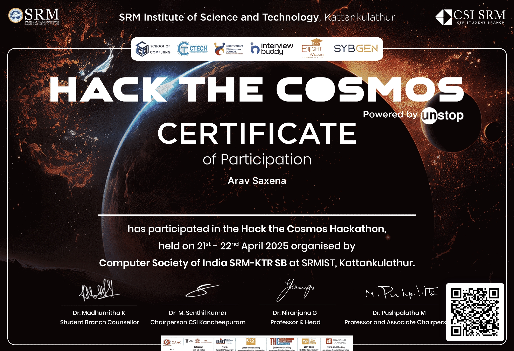
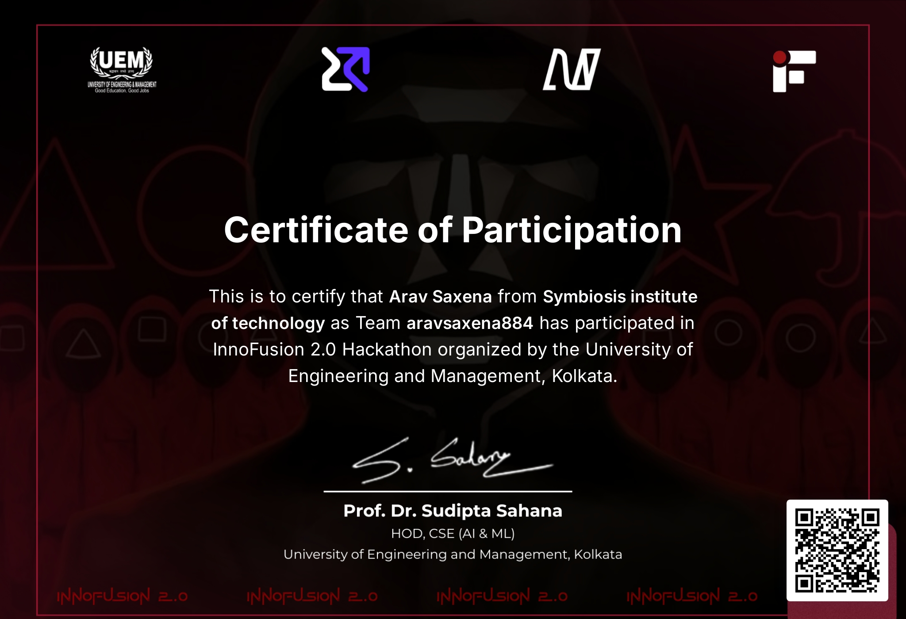
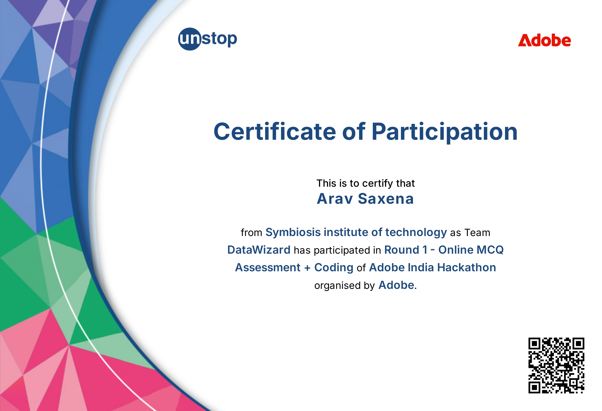
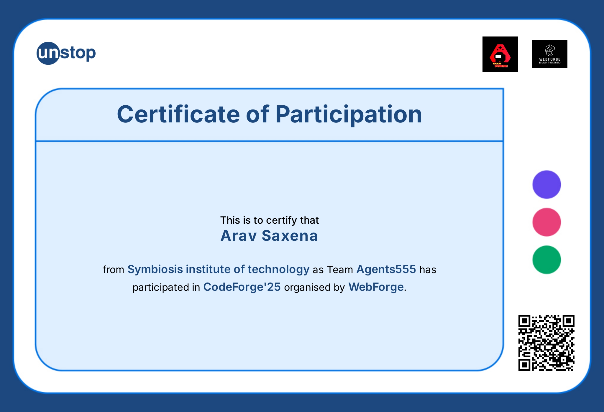
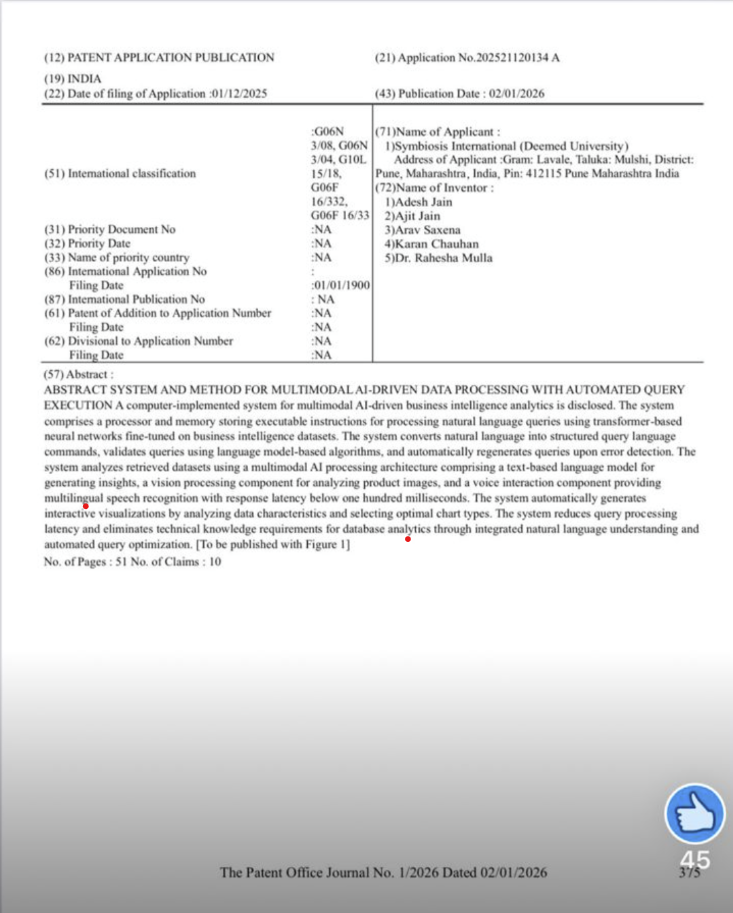

# Certifications

Certificates, course completions and a patent record. Click an image to open it full size.

**Courses and certificates**

- Advanced MCP Topics (Anthropic, 2026)
- Nutanix Certified Associate 6 (Nutanix, 2026)
- Divide & Conquer Algorithms (Stanford Online, 2026)
- Graph Search & Data Structures (Stanford Online, 2026)
- RAG Production Certification (Activeloop, 2025)
- Career Essentials in GenAI (Microsoft & LinkedIn, 2025)
- TensorFlow for Deep Learning (Udemy, 2025)
- Computer Vision & OpenCV (Udemy, 2025)
- Data Analysis Essentials (Microsoft & LinkedIn, 2024)

**Publications and patents**

- *AgCV: An Agentic Framework for Automating Computer Vision Applications*, MethodsX (Elsevier)
- Three published Indian patents (agentic computer vision; context-aware legal reasoning and judicial decision support; multimodal data processing with automated query execution)

<table>
<tr><td width="33%"></td><td width="33%"></td><td width="33%"></td></tr>
<tr><td width="33%"></td><td width="33%"></td><td width="33%"></td></tr>
<tr><td width="33%"></td><td width="33%"></td><td width="33%"></td></tr>
</table>
